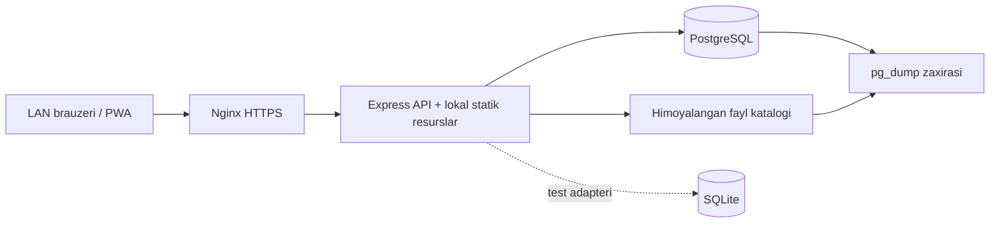
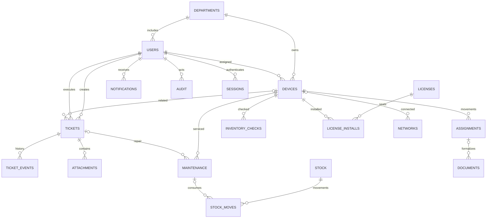

# Arxitektura va API

## Texnologiya tanlovi

Node.js 24+, Express 5, lokal HTML/CSS/JavaScript, PostgreSQL adapteri va test uchun SQLite. Texnik topshiriqdagi Laravel/Django va Vue/React tavsiya sifatida berilgan. Testni ushbu Windows muhitida minimal tashqi infratuzilma bilan ishlatish uchun Node tanlandi. PostgreSQL ishlab chiqarish arxitekturasida saqlandi. Frameworksiz mijoz lokal resurslar bilan ishlaydi va build jarayoniga bog‘liq emas.

## Komponentlar

Brauzerga ma’lumotlar bazasi rekvizitlari berilmaydi. Fayl katalogi `public/`dan tashqarida; yuklab olishda murojaat ruxsati qayta tekshiriladi. SQL faqat parametrli so‘rovlar bilan bajariladi. PostgreSQLda har bir biznes tranzaksiyasi alohida pool connection oladi; qurilma ko‘chirish, ticket statusi, xizmat va litsenziya limitlarida qator blokirovkasi ishlatiladi. SQLite tranzaksiyalari bitta yozuv navbatida serial bajariladi; tashqi so‘rovlar tugayotgan tranzaksiyani kutadi.

## ER modeli

Sxema `server/db.js`da versiyalangan: 1 — asosiy jadvallar va indekslar; 2 — qayta ishlatilgan MFA kodini bloklash uchun `mfa_last_step`. Boshlang‘ich ma’lumotlar faqat foydalanuvchilar jadvali bo‘sh bo‘lganda yaratiladi. Keyingi sxema o‘zgarishlari yangi versiya sifatida qo‘shiladi.

## API shartnomasi

JSON javob; muvaffaqiyatsiz so‘rov `{"error":"..."}`. HTTP: 400 validatsiya, 401 sessiya, 403 vakolat/CSRF, 404 topilmagan yoki ko‘rishga ruxsat yo‘q, 409 ziddiyat, 413 hajm, 429 kirish urinishlari. Mutatsiyalar `X-CSRF-Token` talab qiladi. `POST /auth/login` javobidagi `csrf` keyingi so‘rovlarga yuboriladi; sessiya cookie orqali saqlanadi.

| Yo‘l (`/api` prefiksi bilan) | Usul | Vazifa |
| --- | --- | --- |
| `/health` | GET | Sog‘lomlik, muhit va baza turi |
| `/auth/login`, `/auth/logout` | POST | Kirish/chiqish; admin uchun `otp` |
| `/auth/me` | GET | Joriy hisob va CSRF |
| `/auth/password` | POST | Parol almashtirish, barcha sessiyalarni tugatish |
| `/reference` | GET | Vakolatga mos bo‘lim, xodim va lug‘atlar |
| `/tickets` | GET, POST | Scope bo‘yicha ro‘yxat va yaratish |
| `/tickets/:id` | GET, PATCH | Kartochka, status, ijrochi, izoh va baho |
| `/tickets/:id/attachments` | POST multipart | Himoyalangan fayl ilovasi |
| `/attachments/:id`, `/tickets/:id/pdf` | GET | Ruxsat bilan fayl va PDF ariza |
| `/devices` | GET, POST | Reyestr va yangi qurilma |
| `/devices/:id` | GET, PATCH | Kartochka va texnik holat |
| `/devices/:id/assign` | POST | `employee_id`, `basis`, `confirm`, `expected_updated_at` |
| `/devices/:id/qr`, `/devices/:id/check` | GET / POST | QR SVG va inventar tekshiruv |
| `/device-template`, `/devices-import` | GET / POST multipart | Excel shablon va atomar import |
| `/maintenance`, `/maintenance/:id/complete` | GET, POST / POST | Reja va xizmatni yakunlash |
| `/stock`, `/stock/:id/moves`, `/stock/:id/move` | GET, POST / GET / POST | Nomenklatura, tarix va kirim-chiqim |
| `/networks` | GET, POST | Subnet va IP nazorati |
| `/licenses`, `/licenses/:id/install` | GET, POST / POST | Litsenziya va o‘rnatish |
| `/users`, `/users/:id`, `/users/:id/checklist` | GET, POST / PATCH / GET | Hisoblar va chiqish tekshiruvi |
| `/departments` | GET, POST | Bo‘limlar |
| `/documents`, `/documents/:id/approve` | GET, POST / POST | Hujjat va tasdiqlash |
| `/documents/:id/download?format=pdf\|docx` | GET | Hujjat yaratib yuklash |
| `/exports/:entity?format=xlsx\|csv\|pdf` | GET | Scope va filtr bo‘yicha hisobot |
| `/dashboard`, `/notifications`, `/audit` | GET | Tahlil, xabarlar va audit |
| `/notifications/read` | POST | Xabarlarni o‘qilgan qilish |

Murojaat filtrlari: `q`, `status`, `priority`, `category`, `from`, `to`, `overdue=1`. Qurilma filtrlari: `q`, `status`, `category`, `department_id`, `unassigned=1`. Hozir barcha filtrlarga API javob beradi; UI eng ko‘p ishlatiladigan qidiruv, holat, ustuvorlik va bo‘limni ko‘rsatadi.

## Xavfsizlik qarorlari

Scrypt va tasodifiy salt; bazada faqat sessiya tokenining SHA-256 xeshi; HttpOnly/SameSite=Strict cookie; server ruxsati; CSRF; CSP `script-src 'self'`; HTML escape; fayl hajmi/magic tekshiruvi va majburiy attachment; XLSX ZIP ochilishidan oldin hajm chegarasi; formulali import kataklarini rad qilish; CSV formula injectiondan himoya. Fayl signature tekshiruvi antivirus o‘rnini bosmaydi. JSON tana 256 KB. Muhim jadvallarda tashqi kalit va unikallik cheklovlari bor.

Of­layn loyiha serverga yuborilganda hisob IDsi bilan prefikslangan `client_request_id` bo‘yicha takror so‘rov oldingi ticketni qaytaradi. Mahalliy loyiha qo‘lda yuboriladi va logout vaqtida o‘chiriladi. API, sessiya yoki hisobot service worker keshiga yozilmaydi. LANda PWA uchun ishonchli HTTPS kerak; localhost testida HTTP xavfsiz kontekst hisoblanadi.
